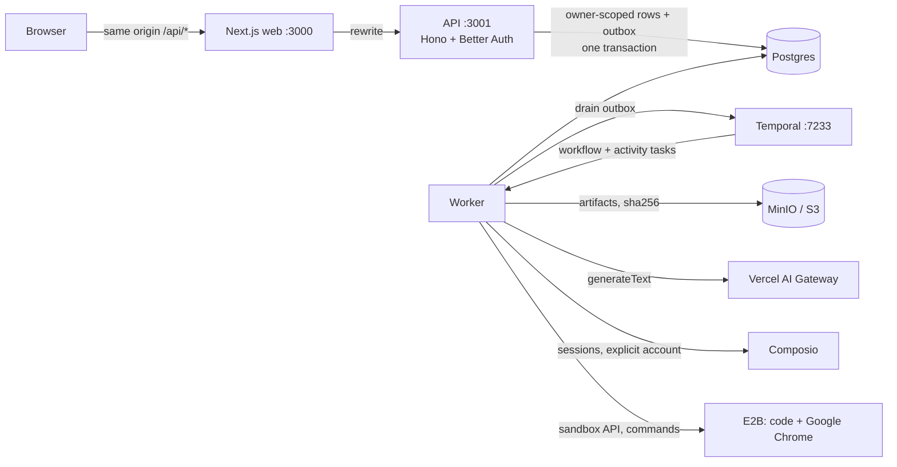

# Architecture

All listeners bind to `127.0.0.1`. The Temporal UI, Postgres, the MinIO console and Chrome DevTools
are never exposed. Chrome's CDP is on sandbox loopback only.

## Request path and dual writes

The API never calls Temporal to change state. Every mutation (create task, decide approval, cancel,
schedule create/pause/resume/delete) commits its rows **and** a `workflow_outbox` row in one Postgres
transaction. The worker drains the outbox every second (`FOR UPDATE SKIP LOCKED`, exponential
backoff, `dead` after 50 attempts).

Every Temporal operation is idempotent:
- Task workflow IDs are `task-<taskId>` with `REJECT_DUPLICATE`.
- Schedule IDs are `sched-<scheduleId>`.
- Approval signals carry only the intent ID.

Schedule rows converge Temporal to the schedule's *current* DB state, so out-of-order processing of
pause/resume/delete is harmless.

Every 60 s a projection reconciler checks tasks that have been non-terminal for a while against
Temporal:
- A queued task whose workflow is missing gets its start re-enqueued.
- A task whose workflow has closed (for example, terminated by an operator) is marked terminal.

Every 15 minutes the worker kills app-tagged E2B sandboxes that no workspace row claims. Sandboxes
still being created and foreign sandboxes are left alone.

## The agent loop (`agentTaskWorkflow`)

Workflow code is deterministic and depends only on `@superagent/contracts`, which lint enforces.
Temporal payloads carry IDs only. Prompts, messages, tool arguments and results stay in Postgres.

1. `loadTaskContext` gets limits, read-only mode and status.
2. Loop until there is a final answer or a limit is hit (20 decisions, 30 tool calls, 15 minutes active):
   1. `modelDecision`: an app-owned, single-step Gateway call with typed tool proposals. Composio and
      AI SDK tools are never auto-executed. The decision is deduplicated per step (`assistant:{step}`),
      so a retried activity never pays twice.
   2. For each proposal, `evaluateProposal` applies the policy:
      - **allow**: `executeTool` (local workspace, browser or connector read).
      - **deny**: the model is told why.
      - **needs_approval**: an immutable intent is created *before* any external write. Then:
        1. `prepareForApprovalWait` pauses E2B.
        2. The workflow waits for an approval signal or the durable expiry timer.
        3. `checkApproval` re-reads the **persisted** approval. A signal alone is never enough.
        4. `executeApprovedAction` runs at most once.
        5. Throws are reconciled via `reconcileAttempt` and are never retried.
3. `finalizeTask`, then `releaseTaskResources` (kill the browser sandbox, pause the code sandbox).

History is bounded by continue-as-new. Cancellation finalizes as cancelled inside a non-cancellable
scope.

## Approvals

An intent's hash is `sha256(canonicalJson({v:1, …binding}))`. The binding includes owner, task, tool
slug and version, connected account, arguments, destination fields, attachments (by sha256 and name),
nonce and expiry. Canonical JSON uses sorted keys, NFC-normalised strings and rejects non-finite
numbers.

The UI shows the exact content and posts the hash and nonce back. Any mismatch, a changed tool
version, a revoked account or an expiry rejects the decision. Attempts move through *not attempted →
in flight → confirmed | failed | unknown*. An *unknown* outcome (for example, a timeout after the
request was sent) is shown to the user and never resent automatically.

## Tool surface

| Class | Examples | Policy |
|---|---|---|
| internal | memory save | allowed |
| workspace | write/read file, run Python, export artifact | allowed; path-checked; E2B internet off by default |
| browser | navigate, read, screenshot, click, type, scroll, download | only on task-approved domains; DNS checked for private ranges; post-navigation recheck blanks the page on violation |
| connector read | GitHub user/repos, Calendar events, Drive search, Gmail fetch | allowed when the user's account is connected and the tool is locked by discovery |
| external write | Gmail draft, Gmail send | always needs exact approval; disabled in read-only (scheduled) runs |

Untrusted content (web pages, emails, documents, repository data) is wrapped in `UNTRUSTED` markers.
The system prompt tells the model to treat it as data.

## Identity and ownership

- Better Auth email/password with HTTP-only `SameSite=Lax` cookies, `Secure` in production, and
  auth rate limits.
- Every repository function takes `ownerId` and filters by it, so cross-owner IDs return 404.
- Mutations require a matching `Origin`.
- The Composio user ID is derived on the server from the owner ID. Callback query parameters are
  never trusted: connections are verified against Composio for that user.

## Residual risks

- Prompt injection can still mislead *read* behaviour and summaries. Policy prevents unapproved
  writes and exfiltration through known channels, not every manipulation.
- Approved browsing domains can host malicious content. The browser is isolated in E2B but runs a
  full Chrome.
- Composio and the model provider are third-party processors of user data.
- Data-protection compliance (PIPEDA, GDPR, CASA for Gmail scopes) requires legal and operational
  work beyond this code. Nothing here claims it.
